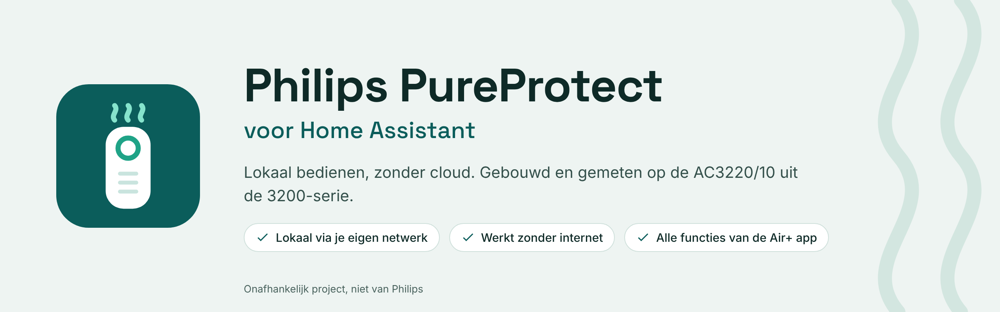

# Philips PureProtect 3200 (AC3220/10) voor Home Assistant

Een lokale Home Assistant-integratie voor de Philips PureProtect 3200-serie. Ze praat rechtstreeks met de luchtreiniger in je netwerk, zonder cloud en zonder account.

**Stand: eerste proefversie (0.1.0).** De integratie is getest tegen een nagebootste luchtreiniger in Home Assistant 2026.11 en onafhankelijk nagelopen. Sinds 23 november 2026 draait ze op een echte AC3220/10 in Home Assistant 2026.11.2; de duurtest loopt.

Een onafhankelijk project, niet van Philips. "Philips" en "PureProtect" zijn merknamen van hun eigenaar en staan hier alleen om aan te geven voor welk apparaat de integratie is.

## Wat de integratie biedt

| Soort | Entiteiten |
|---|---|
| Ventilator | Aan en uit, de standen auto en slaap, vijf snelheden. Medium en turbo van het apparaat zijn hier 60% en 100%. In auto en slaap kiest het apparaat zelf de snelheid; de ventilator toont dan geen percentage. |
| Sensoren | Fijnstof (PM2.5), allergenenindex, temperatuur, luchtvochtigheid, ventilatorsnelheid (stap 1 tot 5, ook in auto en slaap), resterende levensduur van het filter, uren tot reinigen, eindtijd van de timer, tijdstip van het laatste statusbericht |
| Waarschuwingen | Filter vervangen, filter reinigen, storing |
| Schakelaars | Kinderslot, pieptoon, Auto Plus, Allergie-slaap, sensoren in stand-by, display |
| Stand | Eén keuzelijst met alle standen van het apparaat: uit, auto, slaap, medium, turbo en snelheid 1 tot 5. Staat op de apparaatpagina onder Bediening |
| Keuzelijsten | Licht (uit, luchtkwaliteit, sfeerlicht), helderheid (automatisch, laag, fel, uit), scène van het sfeerlicht, timer |
| Knoppen | Filter gereinigd: zet de reinigingsteller terug, zoals de knop in de Air+ app. Nieuw filter geplaatst: zet de resterende levensduur van het filter op vol; alleen na het plaatsen van een nieuw filter |
| Diagnose | Cloudverbinding (zoals de wifi-module die meldt), laatst opgestart, laatste status ontvangen |
| Diagnostiek | Download met tellers van de verbinding en de laatste status, zonder apparaatkenmerken |

Niet beschikbaar, omdat het apparaat ze niet lokaal aanbiedt: het weekschema en de instellingen voor meldingen uit de Air+ app. Gebruik daarvoor automatiseringen in Home Assistant.

Lezen en bedienen zijn voor alle entiteiten op een echte AC3220/10 gemeten. Alleen een storing en een filterwaarschuwing zijn nog niet voorgekomen; hoe het apparaat die meldt, is dus nog niet gezien.

## Hoe ze zich gedraagt

- De luchtreiniger meldt alleen iets als er iets verandert, en in stand-by vrijwel niets. Stilte geldt daarom nooit als storing. Entiteiten worden pas "niet beschikbaar" als het apparaat ruim drie minuten op geen enkele controle antwoordt.
- Krijgt de luchtreiniger een ander IP-adres, dan volgt de integratie dat. Via DHCP als Home Assistant het nieuwe adres ziet, en anders door hem zelf in het netwerk te zoeken als hij vijf minuten niet antwoordt op het oude adres. Een vaste reservering in je router blijft het betrouwbaarst.
- Na een herstart van Home Assistant tonen de entiteiten de laatst ontvangen waarden. De sensor "Laatste status ontvangen" laat zien hoe oud die zijn.
- Een luchtreiniger die uit staat, kan dat niet melden. Antwoordt hij na het opstarten wel op controles, maar komt er tien seconden lang geen status, dan gaat Home Assistant ervan uit dat hij uit staat. Het eerste statusbericht daarna toont de werkelijke toestand.
- Zolang de luchtreiniger uit staat, meet hij niet. Fijnstof, allergenenindex, temperatuur en luchtvochtigheid zijn dan "onbekend" in plaats van de laatste waarde. Met de schakelaar "Sensoren in stand-by" aan toont Home Assistant ook dan wat het apparaat meldt; of het dan blijft meten, is nog niet op het apparaat gemeten. Die schakelaar kun je alleen omzetten terwijl de luchtreiniger aan staat.
- Het apparaat negeert instellingen zolang het uit staat. Weet Home Assistant dat het uit staat, dan stuurt het ze niet en meldt het dat je het apparaat eerst moet aanzetten.
- Een opdracht slaagt pas als het apparaat de wijziging terugmeldt. Gebeurt dat niet, dan krijg je een foutmelding in plaats van een schakelaar die terugspringt.

## Zonder cloud

De integratie heeft geen internet nodig: ze praat alleen met de luchtreiniger in je eigen netwerk. Wil je dat er geen gegevens het huis uit gaan, blokkeer dan het internet van de luchtreiniger.

1. **Kijk waarmee hij praat.** Gemeten op een AC3220/10 (docs/metingen.md, meting 18): vier servers van Amazon, voor de cloudverbinding (AWS IoT in Frankfurt), een REST-dienst en de opslag van firmware-updates.
2. **Blokkeer al het internetverkeer van de luchtreiniger in je router of firewall**, op IP- of MAC-adres. Alleen DNS blokkeren is niet genoeg: een apparaat kan een vaste DNS-server of vaste adressen gebruiken. Verkeer binnen je netwerk tussen Home Assistant en de luchtreiniger (UDP-poort 5683) moet blijven werken. Gebruik je AdGuard Home, zet het adres van de luchtreiniger dan ook bij Instellingen → DNS-instellingen → Toegangsinstellingen → Niet-toegestane clients.
3. **Haal daarna de stekker er tien seconden uit.** Het apparaat houdt zijn verbinding met de cloud open; een blokkade verbreekt een bestaande verbinding niet altijd.
4. **Controleer het resultaat in Home Assistant**, onder Diagnose op de apparaatpagina:
   - "Cloudverbinding" hoort niet langer "Online" te zeggen.
   - Bediening en sensoren werken gewoon door.
   - "Laatst opgestart" blijft staan. Springt die steeds naar nu, dan herstart de wifi-module zichzelf omdat hij de cloud mist; meld dat.

Wat je inlevert:
- Geen firmware-updates meer, ook geen beveiligingsupdates.
- Het weekschema en de meldingen in de Air+ app werken niet meer; maak daarvoor automatiseringen in Home Assistant.
- Bediening via de app buiten je huis werkt niet meer; gebruik daarvoor de Home Assistant-app.
- De luchtreiniger opnieuw met wifi koppelen, bijvoorbeeld na een nieuwe router, kan alleen met de app en tijdelijk internet.

De Air+ app op je telefoon stuurt zelf ook gegevens naar Philips. Gebruik je de app niet meer, dan stopt dat ook.

## Installeren

Vereist: Home Assistant 2026.11 of nieuwer.

Vooraf:
1. Schakel een bestaande integratie voor deze luchtreiniger uit. Twee integraties vanaf hetzelfde adres nemen elkaars statusberichten af.
2. Geef de luchtreiniger in je router een vast IP-adres.

**Via HACS (aanbevolen).** Updates komen dan vanzelf als melding binnen.
1. HACS → drie puntjes rechtsboven → Aangepaste repositories.
2. Repository: `https://github.com/RousseauZ/PHILIPS-PureProtect-3200-serie-AC3220-10-HA-integration`, type: Integratie → Toevoegen.
3. Zoek "Philips PureProtect" → Downloaden, en herstart Home Assistant.

**Of met de hand.** Kopieer de map `custom_components/philips_pureprotect` naar de map `custom_components` in de configuratiemap van Home Assistant, en herstart Home Assistant.

Daarna: Instellingen → Apparaten en diensten → Integratie toevoegen → "Philips PureProtect". Kies **Zoeken in mijn netwerk**, of vul het adres zelf in. Vaak biedt Home Assistant de luchtreiniger ook vanzelf aan onder "Gevonden".

Staat de luchtreiniger tijdens het toevoegen uit, dan toont de ventilator na ongeveer tien seconden "uit" en de ventilatorsnelheid 0. De overige waarden zijn onbekend tot je hem aanzet.

Nieuwe versies staan in [CHANGELOG.md](CHANGELOG.md). Elke versie wordt een release op GitHub, en HACS biedt haar aan als update.

## Dashboardkaart

Een kant-en-klare kaart met de bediening, de luchtkwaliteit met een grafiek van 24 uur, het licht, kinderslot, timer en filter. Ze gebruikt alleen kaarten die in Home Assistant zijn ingebouwd.

1. Open een dashboard en kies Bewerken → Kaart toevoegen → Handmatig.
2. Plak de inhoud van [`docs/dashboard.yaml`](docs/dashboard.yaml).
3. Heet je luchtreiniger niet "Woonkamer", vervang dan overal `woonkamer` door de naam in de entiteits-id's van jouw apparaat.

De knop "Filter reinigen" vraagt eerst om bevestiging, zodat je de teller niet per ongeluk terugzet.

## Documentatie

- [Onderzoeksrapport](docs/onderzoek.md): hoe het apparaat communiceert, waarom de bestaande integraties haperen, en het ontwerp.
- [Metingen](docs/metingen.md): wat op een echte AC3220/10 is gemeten, en wat nog open staat.
- [Meetprogramma](tools/probe/README.md): het programma waarmee is gemeten.
- [Onderzoeksnotities](docs/research/README.md): de onderliggende notities met bronverwijzingen.

## De verbinding proberen zonder Home Assistant

`tools/session_check.py` draait de verbindingslaag van de integratie tegen een echte luchtreiniger en toont elke verandering, de uitkomst van schrijfopdrachten en de tellers. Het heeft alleen het pakket `cryptography` nodig, dat ook het meetprogramma gebruikt.

```bash
cd tools/probe && . venv/bin/activate
python ../session_check.py 10.10.10.113 --set D03103=1 --set D03103=0
```

## Ontwikkelen

De code bestaat uit twee lagen. `custom_components/philips_pureprotect/airlink` is de protocol- en sessielaag en importeert niets uit Home Assistant. De rest van de map is de Home Assistant-laag.

```bash
# Protocollaag, op elke Python vanaf 3.11
python3 -m pytest tests/airlink

# Alles, in een omgeving met Python 3.14, Home Assistant en pytest-homeassistant
uv venv --python 3.14 && uv pip install homeassistant pytest-homeassistant
.venv/bin/python -m pytest tests
```
